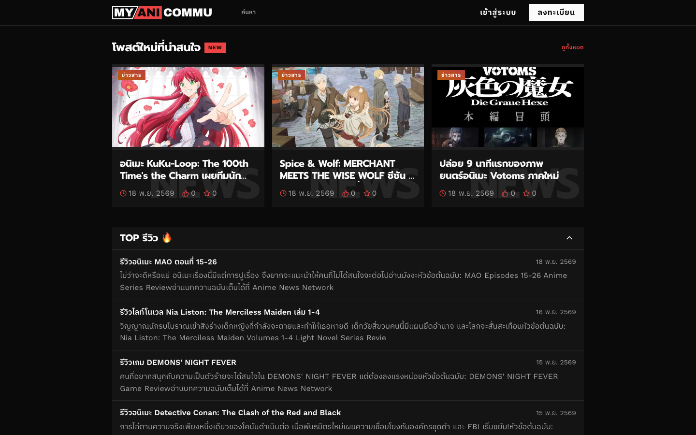

<div align="center">
  
  <h1>MyAniCommu</h1>
  <p>A community website for anime, manga and light novel fans.</p>
  <p>
    <a href="https://myanimecommunity.vercel.app">Live site</a> ·
    <a href="https://github.com/nineria/myanicommu/issues">Report a bug</a> ·
    <a href="CONTRIBUTING.md">Contribute</a>
  </p>
  <p>
    <a href="LICENSE"></a>
    
    
  </p>
  
</div>

## Description

MyAniCommu website purpose is to bring together people who like anime. They can come in and talk and exchange knowledge about anime, manga and light novels.

## Stack

- [Next.js 16](https://nextjs.org/) (App Router, `proxy.ts`) + React 19, TypeScript
- [Clerk](https://clerk.com/) auth (replaces Firebase Auth) with a webhook + lazy user sync
- [Prisma 7](https://www.prisma.io/) + PostgreSQL (replaces Firestore)
- [tRPC 11](https://trpc.io/) + TanStack Query, superjson
- Tailwind CSS 4 + shadcn/ui (Radix), lucide-react, sonner
- Tiptap rich text editor (HTML storage, sanitized with sanitize-html)
- Images stored in Postgres (`Image` table, served from `/api/images/[id]`)
- Biome (lint + format), bun as package manager

## Getting started

```bash
cp .env.example .env.local   # fill in Clerk keys (use a Clerk *development* instance)
bun install
bun run db:setup             # starts Postgres (docker compose, port 54329), migrates, seeds
bun run dev                  # or `bun run dev:all` for mprocs (db, web, studio, lint, seed, migrate)
```

Local auth: either sign in through Clerk with your development keys, or set `DEV_AS_USER=hunter`
in `.env.local` to act as a seeded user without signing in (`hunter` is ADMIN, `sakura` is MEMBER;
only works under `next dev`). Leave `DEV_AS_USER` empty to test the real Clerk flow.

Clerk dashboard: enable *Username*, Google/Facebook social login, and add a webhook to
`/api/webhooks/clerk` (events `user.updated`, `user.deleted`).
Set `ADMIN_EMAILS` so the first admin gets the ADMIN role on sign-up.

Note: scripts run Next on Node (`next dev/build`), not `bun --bun`, because Bun 1.3.x
currently fails `next build` for this Next version.

## Workflow

PRs go against `develop`. When CI passes and there is no conflict, the PR is squash-merged automatically.
`main` is released by a PR from `develop` that you merge by hand.

Notifications (CI, merged PRs, deploys) go to Telegram through the shared `nineria/telegram-notify` relay via a repo webhook.

## Contributing

Contributions are welcome, see [CONTRIBUTING.md](CONTRIBUTING.md). Report security issues privately as described in [SECURITY.md](SECURITY.md).

## License & credits

Released under the [MIT License](LICENSE). You are free to use, modify and distribute this project, but you must keep the copyright notice and license text in all copies or substantial portions.

Created and maintained by **[Nineria](https://github.com/nineria)**. If you build on this project, please credit the original author and link back to <https://github.com/nineria/myanicommu>.
